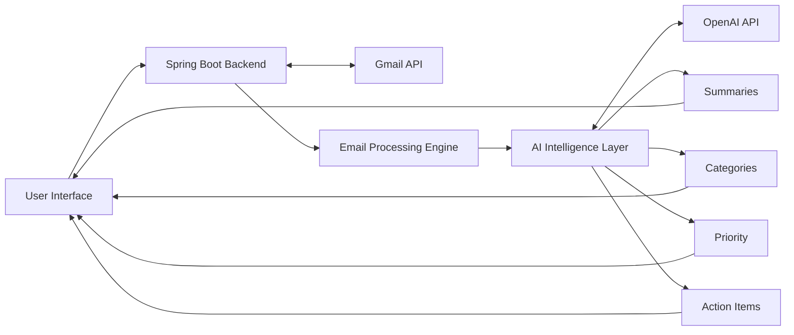

# 📧 MailMind AI

**An AI-powered email assistant that summarizes, prioritizes, and organizes your Gmail inbox.**


MailMind AI connects to your Gmail account and uses AI to understand your conversations. It turns long threads into short summaries, flags urgent emails, pulls out tasks and deadlines, and drafts replies, so you spend less time managing your inbox.

---

## 🚀 Features

- **Email Summarization:** Converts long emails and threads into short, meaningful summaries.
- **Smart Categorization:** Automatically sorts emails into relevant categories.
- **Priority Detection:** Flags urgent and important emails so nothing critical is missed.
- **Action Item Extraction:** Finds tasks, deadlines, meetings, and instructions inside emails.
- **AI Reply Suggestions:** Drafts context-aware replies based on the conversation history.
- **Intelligent Search:** Finds information across your emails.
- **Workflow Automation:** Reduces repetitive email tasks.
- **Gmail Integration:** Works directly with your Gmail account.

---

## 🧠 How It Works

1. **Connect:** Sign in with Google (OAuth 2.0) to securely link your Gmail.
2. **Fetch:** The backend reads your emails through the Gmail API.
3. **Analyze:** The OpenAI API summarizes, categorizes, and prioritizes each email and extracts action items.
4. **Assist:** Results and reply suggestions are shown alongside your inbox.

---

## 🏗️ Architecture



---

## 🛠️ Tech Stack

| Technology | Purpose |
|---|---|
| Java 25 | Backend development |
| Spring Boot | Backend framework |
| Maven | Build management |
| OpenAI API | AI intelligence |
| Gmail API | Email integration |
| Google OAuth 2.0 | Secure authentication |

---

## ⚙️ Getting Started

### Prerequisites

- Java 25
- Maven
- An OpenAI API key
- A Google Cloud project with the Gmail API enabled and OAuth 2.0 credentials

### Run Locally

1. Clone or download this repository and open the project folder.

2. Set your environment variables:

```bash
export OPENAI_API_KEY=your_openai_api_key
export GOOGLE_CLIENT_ID=your_google_client_id
export GOOGLE_CLIENT_SECRET=your_google_client_secret
```

3. Start the application:

```bash
mvn spring-boot:run
```

4. Open `http://localhost:8080` in your browser and sign in with Google.

> Never commit your API keys or secrets. Keep them in environment variables.

---

## 🔒 Privacy & Security

- Authentication is handled through Google OAuth 2.0, so your Google password is never seen by the app.
- Email content is sent to the OpenAI API for processing.
- API keys and secrets are kept in environment variables, not in the source code.

---

## 🔮 Vision

The long-term goal of MailMind AI is an autonomous email assistant that does more than help you read emails. It understands context, surfaces what matters, and handles routine communication work, turning an overloaded inbox into a personal productivity system.

---

## 📄 License

This project is for learning and portfolio purposes.
